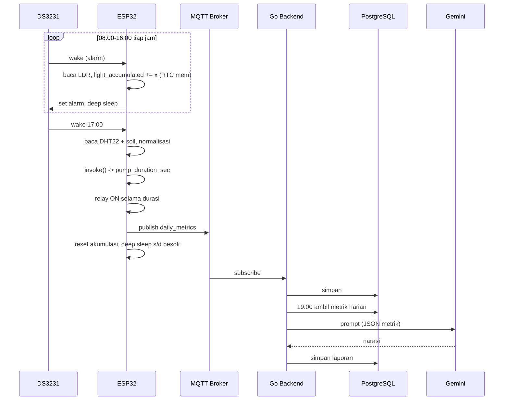

# Arsitektur

## Domain Komputasi
| Domain | Teknologi | Tanggung jawab |
|---|---|---|
| Edge Node | ESP32, C++/PlatformIO, TFLite Micro, DS3231 | Baca sensor, akumulasi cahaya, inferensi, aktuasi pompa, publish MQTT, deep sleep |
| Backend | Go, Mosquitto/EMQX, PostgreSQL, Redis (opsional) | Konsumsi MQTT, simpan, cron laporan, REST API |
| GenAI | Gemini API | Narasi "Kondisi Tanaman Hari Ini" |
| Training | Python, Keras, TFLite | Latih MLP, kuantisasi INT8, ekspor `.h` |

## Diagram Alur

## Keputusan Desain (ADR ringkas)
1. **Inferensi di edge** → otonom tanpa internet. Cloud hanya untuk pelaporan.
2. **RTC DS3231 sebagai pemicu** (bukan NTP) → jadwal andal offline.
3. **MLP dangkal INT8** (4→16→8→1) → muat di RAM/flash ESP32, latensi ≪100 ms.
4. **Satu inferensi/hari (17:00)**; cahaya diakumulasi per jam di RTC memory.
5. **Tanpa `String`** di firmware → cegah fragmentasi heap (target 30 hari tanpa reboot).
6. **Clean Architecture** di backend (mengikuti proyek Catalyst).
7. **Data sintetis dulu** → ganti dengan data lapangan (lihat ROADMAP).

## Titik Kegagalan & Penanganan
| Kegagalan | Penanganan |
|---|---|
| Wi-Fi/MQTT putus | Tetap siram; simpan payload di antrean RTC/NVS, kirim saat terhubung |
| Sensor invalid (NaN/out-of-range) | Gunakan nilai terakhir valid / fallback durasi aman; tandai flag di payload (rencana) |
| Output model di luar rentang | Clamp `[0, PUMP_MAX_SEC]` |
| LLM gagal/timeout | Retry + simpan laporan template berbasis angka |
