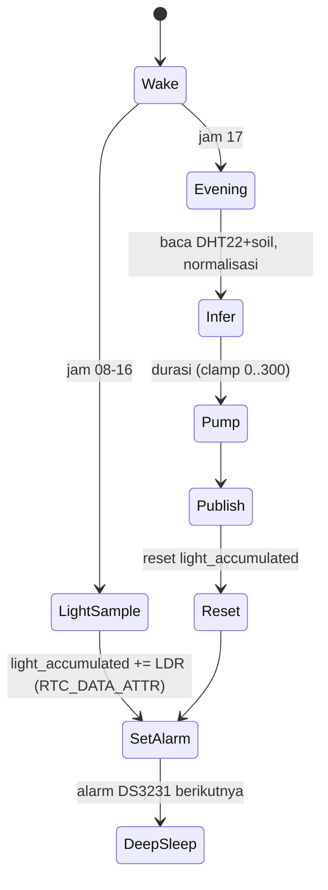

# Firmware (ESP32)

Folder: `firmware/` (PlatformIO, framework Arduino) — **belum dibuat**.

## Struktur Rencana
```
firmware/
├── platformio.ini
├── include/model_config.h      # ranges & PUMP_MAX_SEC (mirror ml/src/config.py)
├── include/agriedge_model_data.h  # salin dari ml/models/
├── src/main.cpp                # state machine
├── src/sensors.{h,cpp}  src/inference.{h,cpp}  src/pump.{h,cpp}  src/mqtt_client.{h,cpp}
└── test/
```

## State Machine


## Aturan Wajib
1. **Tanpa `String`** dan tanpa alokasi heap di jalur berulang; gunakan `char[]` + `snprintf`.
2. `tensor_arena` array statis (mulai 4 KB, tune berdasarkan `arena_used_bytes()`).
3. State persisten lintas sleep: `RTC_DATA_ATTR float/uint32 light_accumulated`.
4. Waktu dari DS3231; Wi-Fi hanya dinyalakan saat publish, lalu dimatikan.
5. Pump: timeout keras, pin LOW saat boot, matikan relay sebelum deep sleep.
6. Setelah `invoke()`, ukur `inference_time_ms` dan sertakan di payload.
7. Quantize/dequantize memakai scale & zero-point dari tensor model.
8. Op resolver minimal: `FullyConnected`, `Relu`, `Logistic`, `Quantize`/`Dequantize` bila perlu.

## Library
`tflite-micro` (mis. `tanakademy/TensorFlowLite_ESP32` atau `espressif/esp-tflite-micro`), `adafruit/DHT sensor library`, `adafruit/RTClib`, `knolleary/PubSubClient`.

## Pengujian
Unit test logika murni (normalisasi, clamp) dengan `pio test -e native`; uji soak 30 hari (acceptance #1) dengan logging reset reason.
